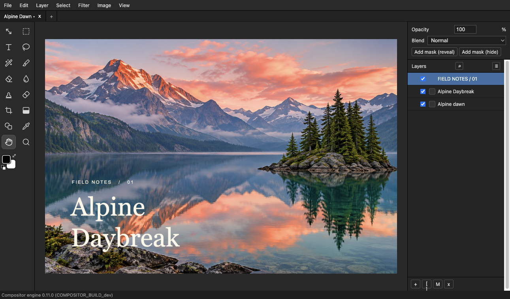
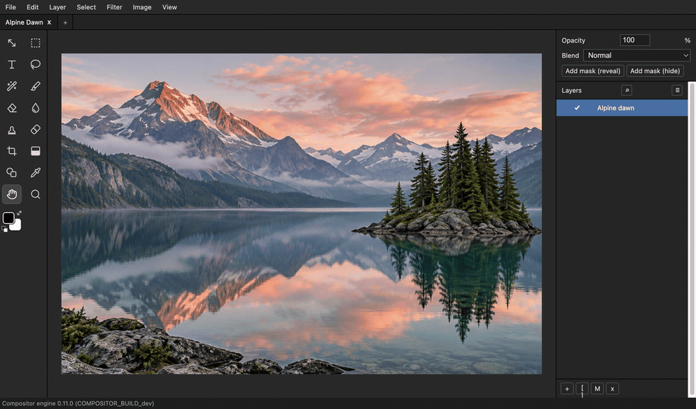

# Compositor for Windows

### 修一张照片，做一张封面，把想法留在图层里。

免费、开源的桌面图像编辑器，用来修图、制作分层图文和编辑小段 GIF 动画。

**[下载 Windows 版](https://github.com/jsun2020/compositor-windows/releases/latest)** · [看操作演示](#九秒钟看一次调色) · [English](README.md)

*一张照片也能变成封面：调好颜色，加上标题，文字仍然可以继续编辑。*

## 长什么样，好不好上手？

左边选工具，中间看画布，右边管图层。裁剪、调色、叠加图片和文字，都在同一个工作区完成。调整时可以先预览再应用；用过其他图像编辑器，常见的 **B 画笔、T 文字、Ctrl+Z 撤销** 也能直接用起来。

## 九秒钟看一次调色

打开 **Image → Hue/Saturation**，提高饱和度，切换 **Preview** 对比前后，最后应用。

[观看无声 MP4](docs/media/color-preview.mp4) · [查看完整调色截图](docs/media/editor-color.png)

*截图和录屏来自 0.11.0 实际编辑器前端的浏览器预览。Windows 使用同一编辑界面；原生窗口边框、对话框和字体可能不同。[素材说明](docs/media/README.md)。*

## 它能帮你做什么？

| 想完成的工作 | 可以用到的工具 | 得到什么 |
| --- | --- | --- |
| 给旅行照、商品照做最后一轮修整 | 裁剪、色阶、曲线、调色、仿制图章、污点修复 | 可直接分享的 PNG 或 JPEG |
| 做社交封面、海报、视频缩略图 | 图片图层、可编辑文字与形状、蒙版、混合模式、描边和阴影 | 导出成图，同时保留可修改的 `.comp` 工程 |
| 显影相机 RAW 照片 | 传感器解码、曝光、白平衡、曲线与 Camera Raw 调整 | 可继续叠加图层编辑的照片 |
| 修改一小段 GIF | 帧编辑、时长调整、播放预览 | GIF 动画 |

也支持 **16 位／HDR 图层、PDF 页面与 HEIF 导入、部分 PSD／PSB 内容**，以及使用打印机 ICC 配置文件进行 **CMYK 软打样与导出**。复杂生产文件请先查看[格式支持与限制](docs/technical-reference.md#camera-raw-and-photoshop-import)。

## 已经有其他修图工具，为什么还值得试？

- **随手打开，完成一件具体的事。** 解压便携包就能运行，适合快速修图、做封面和组合图层。
- **在本地编辑，不必注册账号。** 编辑图片不需要上传云端，也不需要订阅。
- **留住下一次修改的余地。** 工程保存文字、形状、蒙版和图层，下次改标题或换图时可以接着做。
- **免费开源，可以查看和改造。** 编辑器采用 MIT 许可，源码和构建方法都在这个仓库里。

可以把它作为现有工作流中的另一件工具。复杂 Photoshop 文件并不保证完整还原，Mac 与 Windows 的渲染也可能不同；重要文件先用副本尝试。

## 从第一张图片开始

1. **[下载最新 Windows x64 ZIP](https://github.com/jsun2020/compositor-windows/releases/latest)**，完整解压，保留所有辅助程序、DLL 和许可文件。
2. 打开 **`Compositor.exe`**，通过 **File → Open** 打开图片。需要 Microsoft Edge WebView2 Runtime，无需安装 Node 或 Rust。
3. 试试 **Image → Hue/Saturation** 或 **Curves**，对比预览后导出 PNG／JPEG。需要继续修改时，另存为 `.comp` 工程。

`.comp` 工程是文件夹，移动或分享时请保留全部内容。当前提供未签名的便携版，没有安装器和自动更新；发布页面附有下载校验值。

<strong>几个马上能用的快捷键</strong>

| 操作 | 快捷键 |
| --- | --- |
| 移动／文字／画笔 | V / T / B |
| 裁剪／抓手／缩放 | C / H / Z |
| 色阶／曲线／色相饱和度 | Ctrl+L / Ctrl+M / Ctrl+U |
| 复制图层 | Ctrl+J |
| 撤销 | Ctrl+Z |
| 应用／取消变换 | Enter / Escape |

[完整快捷键表](docs/technical-reference.md#shortcuts)

## 最近更新

**Windows 0.11.0** 对齐 Mac 1.5.7，带来高精度编辑、GIF 工具、PDF 与内置 HEIF 导入、CMYK 工作流、新效果和工作区改进。[查看版本说明](docs/releases/0.11.0.md)。

发现问题或有建议，欢迎 **[提交 Issue](https://github.com/jsun2020/compositor-windows/issues)**，说明操作步骤、软件版本，并在方便时附上可公开的小样例。

---

[构建与贡献](docs/technical-reference.md#build-and-test) · [兼容性说明](docs/technical-reference.md#interoperability-and-limits) · [验收报告](pair-test-report.md) · [历史版本](https://github.com/jsun2020/compositor-windows/releases)

移植自 macOS 版 Compositor，使用 Tauri、Rust/WebAssembly 和 React。原始 Compositor 源码及修图内核采用 MIT 许可，[Lucide](https://lucide.dev) 图标采用 ISC 许可。解码器许可与声明随发布包提供。
